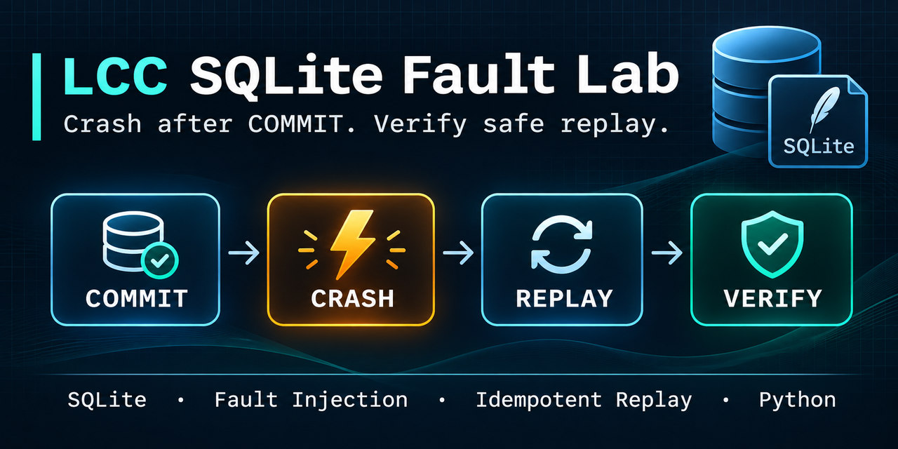
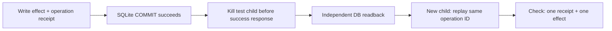

# LCC SQLite Fault Lab



[](https://github.com/KenKan964/lcc-sqlite-fault-lab/actions/workflows/tests.yml) · **Python 3.11+** · **MIT** · **Experimental**

**Crash after COMMIT. Verify safe replay.** Reproduce a precise failure in a **synthetic SQLite test database**: terminate the test worker after its COMMIT succeeds but before it acknowledges success, restart using the same operation ID, then check the saved effect and receipt.

**COMMIT直後に停止したら？** 合成SQLite DBで停止・再起動・同じ操作IDの再投入を再現し、二重の業務効果が発生していないかを確認する無料の実験用CLIです。

[日本語ガイド](#日本語) · [English guide](#english) · [Technical specification](TECHNICAL_SPEC.md) · [Safety boundaries](SECURITY.md)

## See it in 30 seconds / 30秒デモ

```bash
python demo.py --out ./demo_run_001
```

The output directory must **not** already exist; reruns need a new name. Python 3.11+ and its standard library are all you need. No installation, network service, production DB, or external process target is required.

**What is actually tested / 検査の流れ:**



**Expected summary excerpt** (the real output also includes a local `report` path and metadata; a fresh run is not asserted to use the same PID or path):

```json
{"total":4,"passed":4,"all_expectations_met":true}
```

| Test scenario | Expected diagnostic | What the lab observes |
| --- | --- | --- |
| `after_commit` | `SAFE_IDEMPOTENT_REPLAY` | Commit succeeded; initial response was lost; replay with the same ID creates no second effect |
| `duplicate` | `KNOWN_BAD_DETECTED` | Intentionally broken worker writes a duplicate effect |
| `false_complete` | `KNOWN_BAD_DETECTED` | Broken worker announces success without saving anything |
| `unsafe_replay` | `KNOWN_BAD_DETECTED` | An intentionally bypassed safety guard causes replay while the saved result is unknown |

**Read the evidence:** [`summary.json` example](examples/expected_summary_excerpt.json) · [`demo walkthrough (日本語)`](docs/DEMO_WALKTHROUGH_ja.md). A **passing known-bad test means the defect was detected**, not that the broken code was safe.

> **Limits:** This is an experimental synthetic Python/SQLite lab, **not** an assurance of safety for arbitrary SQLite apps. It does **not** simulate actual power loss, SQLite internal crash points, fsync/disk faults, external side effects, or a real Drift/Room integration. No verified time savings or commercial advantage are claimed.

---

## 日本語

### 30秒クイックスタート

Python 3.11以降を使用。追加パッケージ、サービス、インターネット接続は不要です。

```bash
python demo.py --out ./demo_run_001
```

出力先は**存在しない新しいディレクトリ**を指定してください。既存のディレクトリやDBを上書きしません。別の実行では新しい名前を使います。

成功すると以下のように表示されます（パスは実行環境によって異なります）。

```json
{"report":"/.../demo_run_001/summary.json","total":4,"passed":4,"all_expectations_met":true}
```

**確認するファイル**：

- `demo_run_001/summary.json` — 全ケースの判定と証拠パス
- `demo_run_001/after_commit/result.json` — 実際の停止位置、停止したプロセス、再起動したプロセス、同じ操作IDの再投入と重複防止
- `demo_run_001/after_commit/trace.jsonl` — `checkpoint`、`kill_requested`、`recovery`、`spawn`、`result`などの時系列
- `demo_run_001/after_commit/lab.sqlite` — **生成した合成テストDB**。`receipts`、`effects`の各テーブルに1行ずつ保存
- `duplicate`、`false_complete`、`unsafe_replay` ディレクトリ — 意図的な欠陥を検出した証拠

### デモで確認する5段階

1. SQLiteの同一トランザクション内で、業務効果と操作IDの`receipt`を保存。
2. `COMMIT`の成功後、アプリへの`COMPLETED`応答を出す**前**にチェックポイントで待機し、子プロセスを強制停止。
3. 親プロセスがSQLiteを**別の読取り接続**で照合。保存結果が確認できてから`COMPLETED`を判断。
4. **新しい子プロセス**を起動して同じ操作IDを再投入。既存receiptを確認し、業務効果を再実行せず`replayed=true`を返す。
5. SQLiteの`quick_check`・receiptとeffectの一致・件数・子イベントを検査し、JSONへ出力。

正常例と「故意の不正」の合計4件です。

| ケース | 期待結果 | 証明する内容 |
|---|---|---|
| `after_commit` | `SAFE_IDEMPOTENT_REPLAY` | COMMIT後停止→新プロセスから同一ID再投入→効果1件 |
| `duplicate` | `KNOWN_BAD_DETECTED` | 不正な実装の二重業務効果を検知 |
| `false_complete` | `KNOWN_BAD_DETECTED` | 保存していないのに完了と返す実装を検知 |
| `unsafe_replay` | `KNOWN_BAD_DETECTED` | 読戻し不能で`HOLD_UNKNOWN`のまま再投入する欠陥を検知 |

**重要：** 欠陥ケースの`passed=true`は、**欠陥を正しく検出できた**という意味であり、不正なアプリを安全だと認定した意味ではありません。

単独で実行する場合：

```bash
python demo.py --out ./demo_single_001 --case after_commit
python demo.py --out ./demo_bad_001 --case duplicate
```

DEV-001全ケースT01〜T06の比較実験を再実行する場合：

```bash
python cli.py run --mode both --case T02 --repeat 1 --out ./compare_t02_001
python cli.py run --mode lcc --case T06_unsafe --repeat 1 --out ./detect_unsafe_001
```

### テスト

```bash
python -m unittest discover -s tests -v
python -m unittest discover -s . -p test_safety.py -v
```

GitHub Actionsも同じテストをLinux上で実行する設計です。CIに本番DBや秘密情報は不要です。

### 安全・適用範囲

- 毎回、新しい空ディレクトリに**合成SQLite DB**を作成する。既存DB・任意の実行プロセスを入力するAPIはない。
- 停止するのは当CLIが生成し、明示的チェックポイントで待機している**試験用子プロセスのみ**。任意PIDの停止はしない。
- 元のDBを同一トランザクション内で確定したことと、アプリがその結果を認識したことは別扱い。
- **保証外**：実電源断、SQLite内部の任意位置での停止、ディスク破損やfsync故障、別ホストの処理、外部API・送金等の副作用、別の未観測writer、任意業務システムへの接続、Drift/Roomの実統合、全OSでの動作保証。
- 読戻し不能時は正常な完了を推定しない。`HOLD_UNKNOWN`の場合は安全な再投入を禁止する。
- CLIのsandbox tokenは**誤操作防止**の仕組みであり、同一権限の悪意あるプロセスに対するセキュリティ境界ではない。
- Windowsでの実機検証は未完了。Linux上で検証済み。Windowsはプロセス終了コードの表現が異なる場合がある。

技術説明：[`docs/DEMO_WALKTHROUGH_ja.md`](docs/DEMO_WALKTHROUGH_ja.md) / [`TECHNICAL_SPEC.md`](TECHNICAL_SPEC.md)。開発・公開上の注意：[`SECURITY.md`](SECURITY.md)、[`PUBLISH_CHECKLIST.md`](PUBLISH_CHECKLIST.md)。

## English

### Quick start

Requires Python 3.11+; no third-party packages:

```bash
python demo.py --out ./demo_run_001
python -m unittest discover -s tests -v
python -m unittest discover -s . -p test_safety.py -v
```

The output directory **must not exist**. This project creates only synthetic SQLite databases and stops only child processes it starts. See `summary.json` and `after_commit/result.json` in the new output directory. The demo proves one *bounded, synthetic* failure scenario only — not crash safety for arbitrary SQLite apps, Android Room or Flutter Drift.

A negative-control run reporting `passed=true` means its **injected defect was detected**, not that the defective implementation is safe. Human setup and diagnostic effort were not measured; performance and labor-hour benefits are not claimed.

### Repository contents

| File | Purpose |
|---|---|
| `demo.py` | Four public demos, explicit readback and evidence assertions |
| `worker.py` | One-shot synthetic operation, exact barriers before/after commit |
| `lab.py` | Test-only Popen child control, SQLite lock fixtures, trace log |
| `adapter.py` | New sandbox DB, operation ID receipts, independent DB readback |
| `engine.py` | Recovery decisions, fail-closed checks, diagnostic oracle |
| `cli.py`, `plans.json`, `oss_baseline.py` | DEV-001 scenarios and fair OSS-only comparison |
| `tests/test_demo.py`, `test_safety.py` | Public acceptance tests and safety contracts |
| `.github/workflows/tests.yml` | Linux CI tests and public demo smoke run |

**License:** MIT (see [`LICENSE`](LICENSE)), subject to the publisher confirming they hold the necessary rights to contributed source. No third-party source repository is redistributed. The project is not affiliated with SQLite, Drift or Room.
